# FlowQR: art direction and UI audit

Scope: the whole frontend (33 routes), a small additive backend change, and the tooling used to review it.
Screenshots are in [`docs/ui-audit/`](ui-audit/) (desktop 1440 px, tablet 820 px, mobile 390 px) and were captured from the
production build against an isolated, seeded **demo stack**. Every business, review and card in them is synthetic (see
[Demo data](#demo-data-and-how-to-reproduce-this-review)).

## 1. Audit: what was wrong

### Repeated layout patterns that made it look generic

| Pattern | Where it appeared | Effect |
| --- | --- | --- |
| Page header, then a vertical stack of identical rounded cards | every route | no hierarchy; every screen felt the same |
| A 4-up KPI card grid | dashboard, analytics, admin, Google profile | numbers without meaning or priority |
| Capsule buttons, heavy pills for every status | everywhere | visual noise; status unreadable in tables |
| Dashed empty-state rectangles | cards, reviews, locations, photos | large blank areas that explain nothing |
| Gradients, glass, glow, sheen, floating chips | landing, shell, charts | the "AI template" look |
| Detail screens as separate pages | reviews | the core workflow needed a back-and-forth |
| Identical cards for physical products | cards, locations | the card as a physical object appeared nowhere |

### The five weakest pages (before this round)

1. **Reviews inbox**: a stack of cards, one page per review, no workspace.
2. **QR/NFC cards**: generic text rows; no card artwork, last scan, or QR/NFC state.
3. **Locations**: identical cards that did not say which branch was connected to Google, syncing, or missing a link.
4. **Google connection**: a text card, a checkbox list, a dashed empty state.
5. **Landing page**: a template hero with a floating card, feature lists without product demonstrations, large blank areas.

## 2. Art direction

**Concept: physical review collection plus digital reputation management.** The card is the product's recurring object, and it is
the real one: the **FlowQR review poster** supplied as the print file (`FlowQR_Review_Poster_Print_Readyfinal.pdf`, 89 x 126 mm,
one embedded 1055 x 1491 px image). It is cut to its card shape (transparent corners, WebP, 112 KB) and appears wherever the
product is about cards: landing hero, annotated product section, card inventory, card detail, first-run dashboard and sign-in.
Paused or unassigned cards are the same artwork, muted and labelled. The in-app UI stays graphite, warm white and cobalt, so the
poster is the loudest thing on screen; the marketing page borrows the poster's own orange for its product and closing bands.

### Colour (tokens in [`tailwind.config.ts`](../frontend/tailwind.config.ts))

| Token | Role | Notes |
| --- | --- | --- |
| `ink` (warm graphite, `ink-50` = warm white page) | text, borders, surfaces | body text 7.5:1 on white; control borders `ink-300` 3.5:1 |
| `brand` (cobalt) | the one interactive colour: primary actions, links, selection, focus | `brand-600` 8.0:1 on white |
| `flow` (FlowHQ orange) | parent-brand marks: logo and wordmark; on the marketing page also the product and closing bands, to match the poster | never a button or link. Graphite text on `flow-500` is 5.6:1; orange text uses `flow-700` (5.7:1) |
| `gold` | NFC/tap mark and Google rating stars only | `gold-600` text 4.5:1 |
| green / amber / red | status only | always paired with words, never colour alone |

### Typography

Geist (UI and headlines) with Geist Mono for card IDs, tokens and URLs, plus Noto Sans Devanagari as the Hindi fallback.
Scale: page title 20-22/700, panel title 14-15/600, body 14-15/400, metadata 12-13/400-500, large numerals 26-44/700 with tabular figures,
eyebrow labels 11-12 uppercase tracked. No heading above 3.5 rem (landing hero only). One family, one mono: no more.

### Shape, density and interaction

8 px radius on controls, 10 px on panels (no capsules except small status chips). Hairline borders, one soft shadow reserved for objects
that float (modals, the physical card, hero). Dense by default on pointer devices (32-36 px controls) and 44 px on touch. Status is a
dot plus words. Every button has a press state; motion is limited to one-time reveals, a two-pass tap ripple on the card, and chart
draw-in, all disabled under reduced motion. Glass and blur are removed everywhere.

### Brand assets

Apart from the supplied poster artwork (used as-is, only cropped to the card shape), the repository contains **no FlowHQ image assets**
(`frontend/public` held only `.gitkeep`). The only logo in the project was the orange tile with the QR-flow glyph drawn in [`Brand.tsx`](../frontend/src/components/ui/Brand.tsx). An earlier pass in this work
replaced it with a redrawn mark; this pass **restored the original unchanged**. No replacement logo was invented.

## 3. What changed, by group

### Group 1: marketing, pricing, sign-in
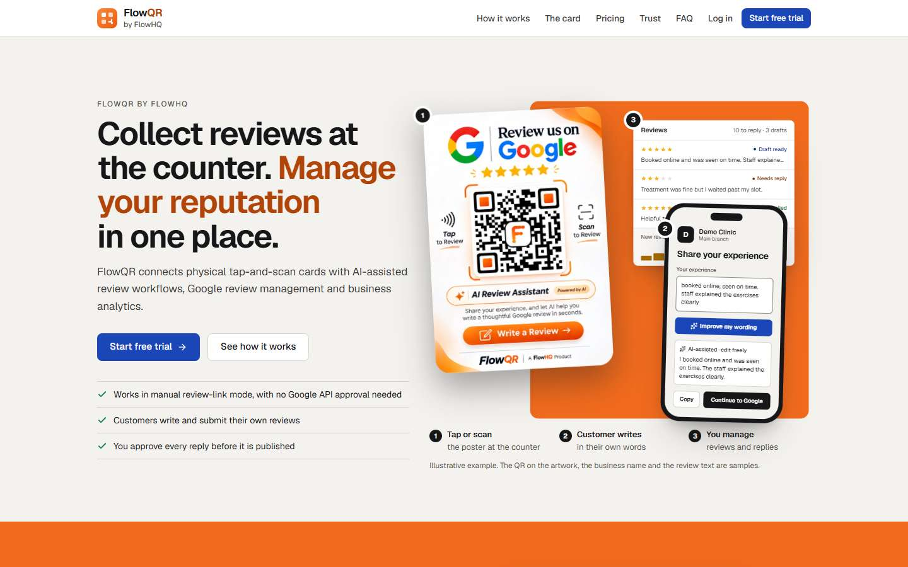

* **Landing** is a product page with eleven distinct sections: hero, the card (annotated), how it works, AI review assistance, Google
  review management, card management, multi-location, analytics, pricing, compliance and trust, FAQ, then a closing band and footer.
  Every section has a different layout (split hero on an orange block, numbered annotation, ruled process strip, UI composition,
  annotated full-width workspace, graphite card band, offset screenshot, definitions beside a chart, comparison table, does/never-does
  pair, accordion).
* **Hero** puts the real poster on a block of FlowHQ orange (the artwork's own colour) with the customer's phone and a fragment of the
  owner's dashboard layered beside it, numbered 1-3. The phone and dashboard are built from the product's own components.
* **The card section** annotates the poster element by element (Review us on Google, Tap, Scan, AI Review Assistant, Write a Review), and
  says plainly that the button on a printed card is artwork, so the action is the tap or the scan.
* **Real product screenshots** (reviews, locations, analytics) are captured from the running app by
  [`e2e/capture-product-shots.js`](../e2e/capture-product-shots.js) and shown in a labelled frame ("Illustrative example · demo data").
* **Pricing** is one comparison table (a plan switcher on phones) shared by the landing page, `/pricing` and the in-app subscription page.
  It uses live plans from the API with a built-in fallback.
* Removed: fabricated testimonials and metrics, marquee, tilt, typewriter, count-up, floating chips, gradient text, blobs.

| Landing, mobile | Pricing, mobile | Sign-in |
| --- | --- | --- |
| 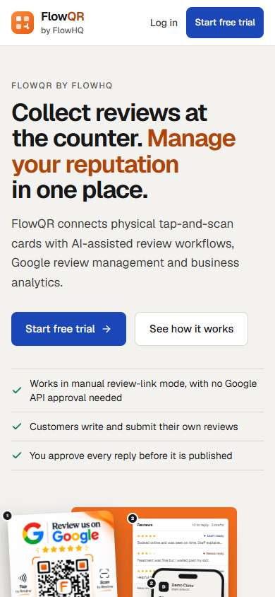 | 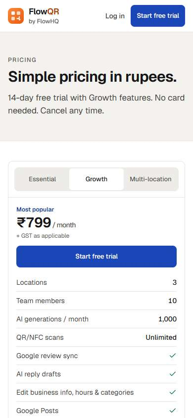 | 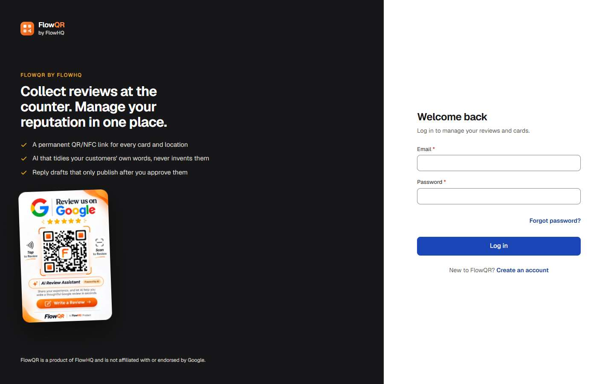 |

### Group 2: dashboard, reviews inbox, reply editor
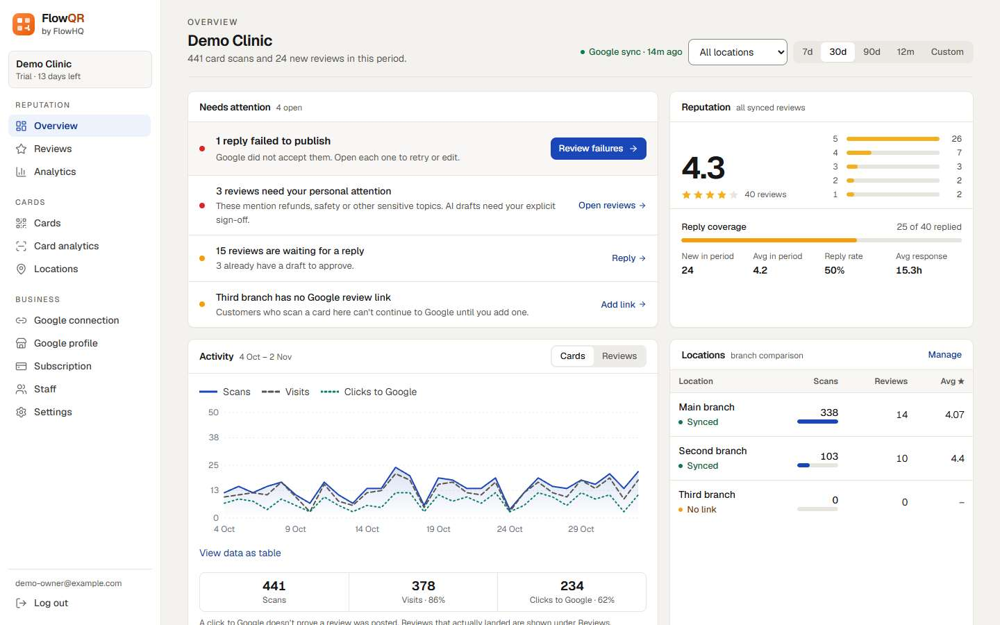

* **Dashboard** is organised by operational priority: a *Needs attention* list built from real data (failed replies, sensitive
  reviews, reviews awaiting reply, sync problems, locations with no review link, quiet cards), a composed *Reputation* panel
  (rating, distribution, reply coverage), an *Activity* chart that switches between card and review data, a branch comparison,
  and recent reviews and cards. No decorative KPI tiles. New businesses see a computed setup checklist and a preview of their card.
* **Reviews** is a persistent two-pane workspace (list left, selected review and reply editor right). Filters and selection survive moving
  between reviews, deep links work (`/reviews?state=failed`), and it opens the first review that needs attention. Unanswered, draft, approved,
  failed, published and sensitive reviews each have a distinct treatment. The reply editor shows Draft, Approved and Published
  progress, the AI-draft label, the human acknowledgement for flagged reviews, and the response history.

| Reviews, desktop | Reviews, tablet | First-run dashboard |
| --- | --- | --- |
| 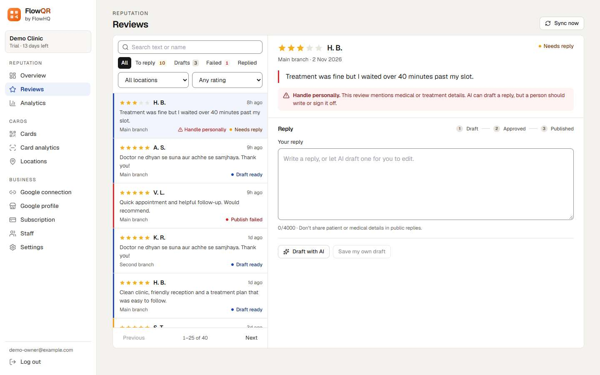 | 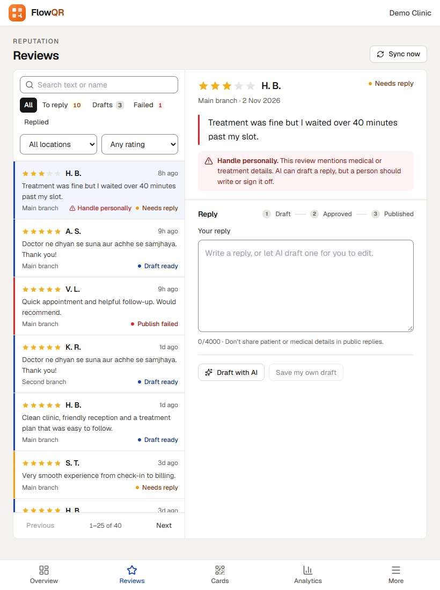 | 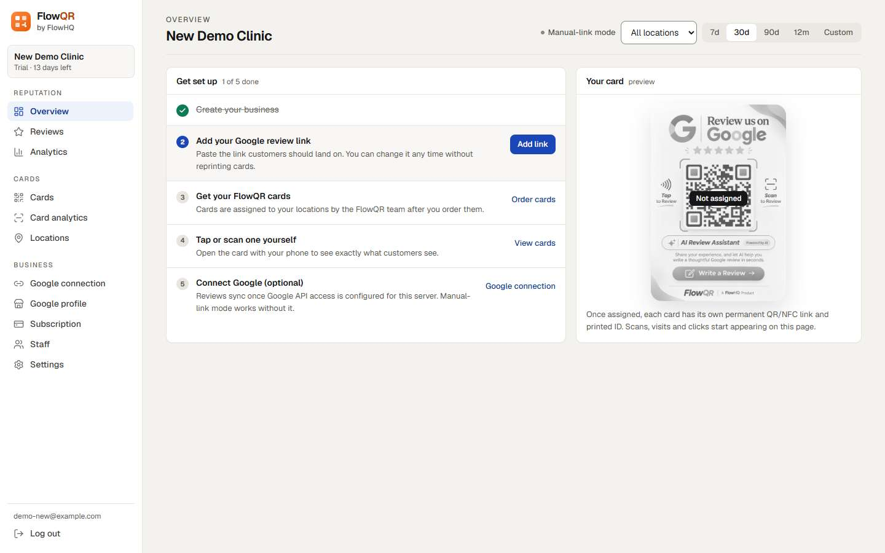 |

### Group 3: cards, assignment, card analytics
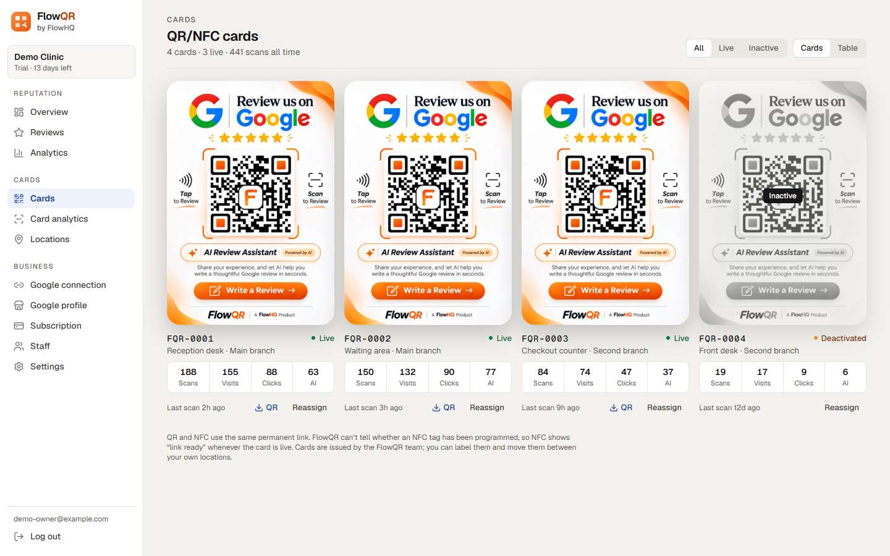

* **Cards** shows each card as the real poster artwork (muted when deactivated or unassigned) with ID, status, scans, visits, clicks, AI uses and last scan, plus a table view.
* **Card detail** (`/cards/[id]`) has the card, the real downloadable QR, the permanent link and NFC programming notes, status
  (activation, QR/NFC, location, assigned date, last scanned), and a funnel for the chosen date range, with reassign, deactivate,
  reactivate and report-lost actions.
* **Card analytics** ranks cards by scans with visit and click rates and last scan, compares locations, and explains how each number is counted.
* **Assignment**: owners and admins label and move cards between their own locations (history is kept). Platform admins assign from the inventory.

| Card detail | Card analytics | Empty (no cards yet) |
| --- | --- | --- |
| 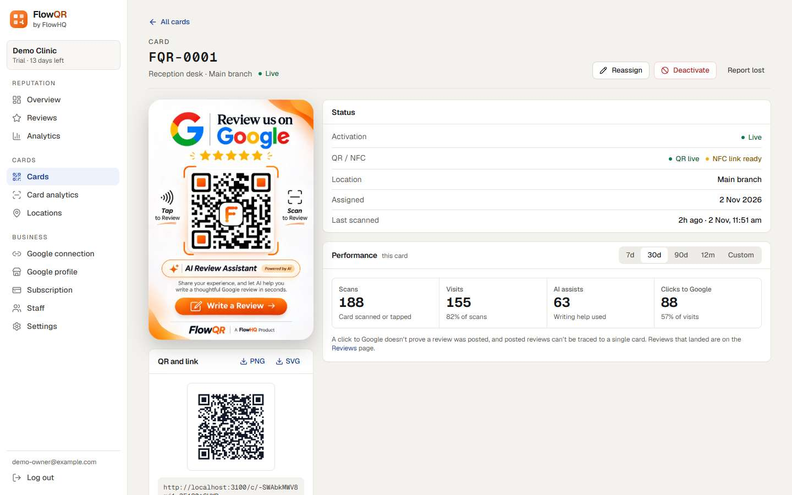 | 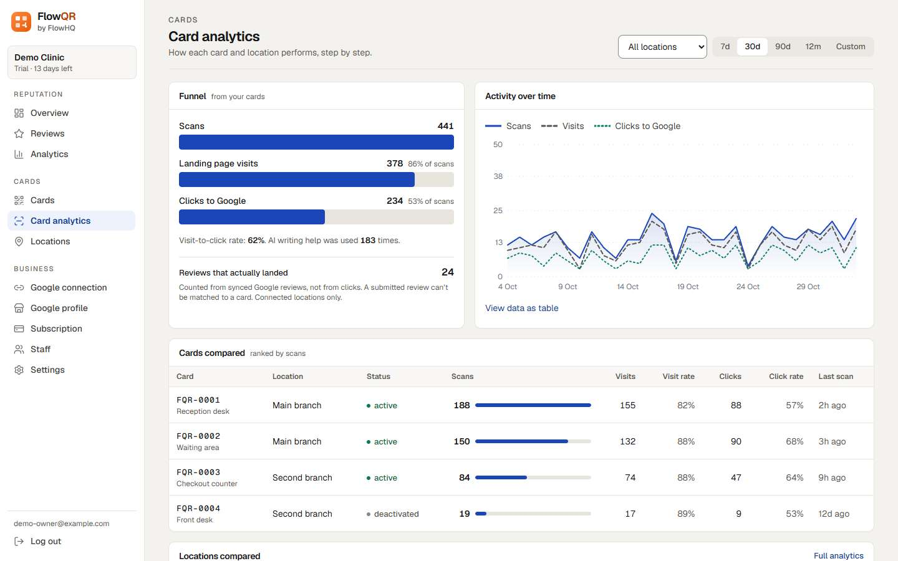 | 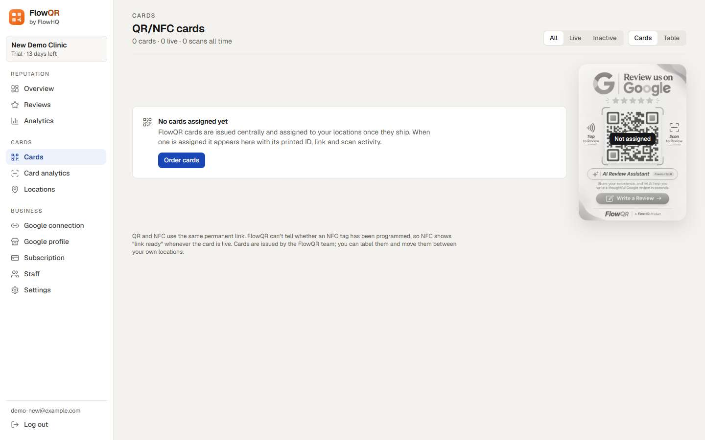 |

### Group 4: locations, Google connection, Google profile
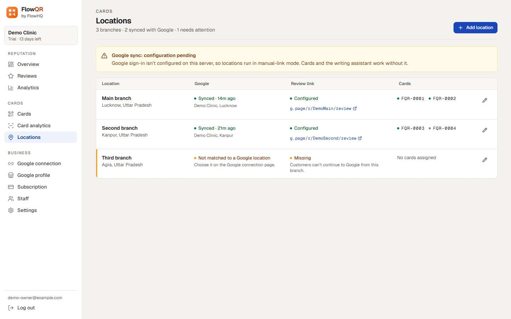

* **Locations** is a branch ledger: Google sync state per branch (synced / waiting / error / rate-limited / not matched / manual link),
  the configured review link (testable), and the assigned cards with their status. Branches that need attention are marked.
* **Google connection** states the current mode, what works in manual-link versus connected mode, real sync facts, and a clear
  *configuration pending* state when the server has no Google credentials. Google profile tools show the same pending state instead of a red error.

### Group 5: analytics, subscription, staff, settings, payments, admin
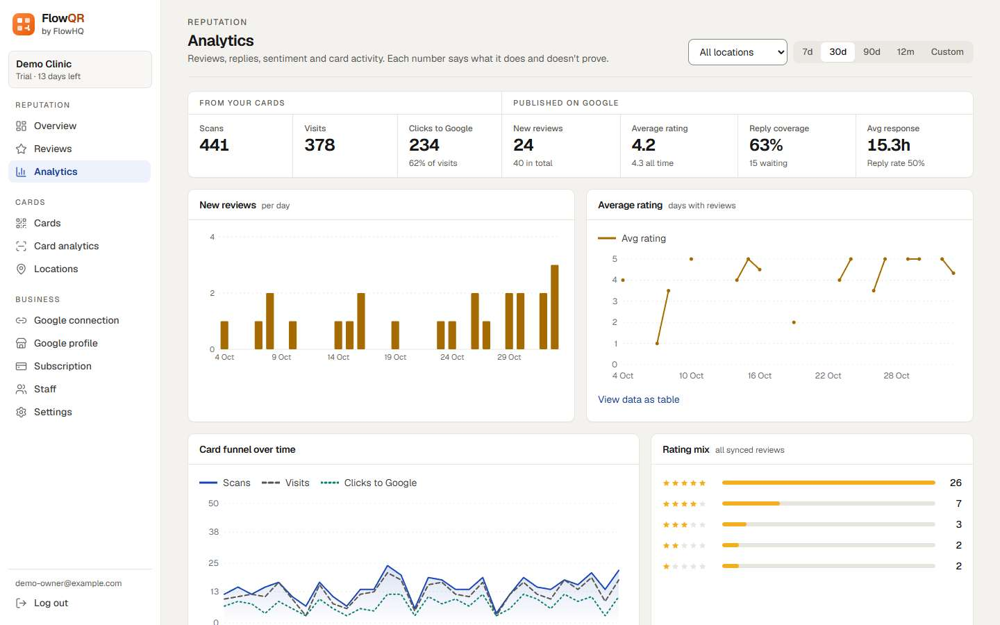

* **Analytics** separates *From your cards* (scans, visits, clicks) from *Published on Google* (new reviews, rating, reply coverage,
  average response), with review volume, a rating trend that leaves gaps on days without reviews, funnel over time, location and card comparisons,
  sentiment and topics, and AI usage.
* **Staff**, **Settings** (section index plus panels), **Payments**, **Subscription** and the **five admin pages** adopt the same
  panel, table, status and form treatment. Admin overview is organised by revenue, inventory and attention.

| Staff | Settings | Admin |
| --- | --- | --- |
| 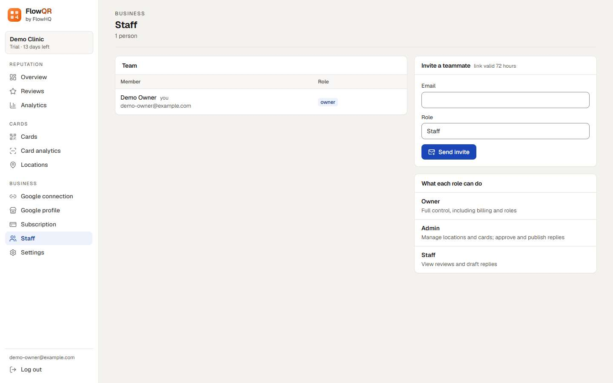 | 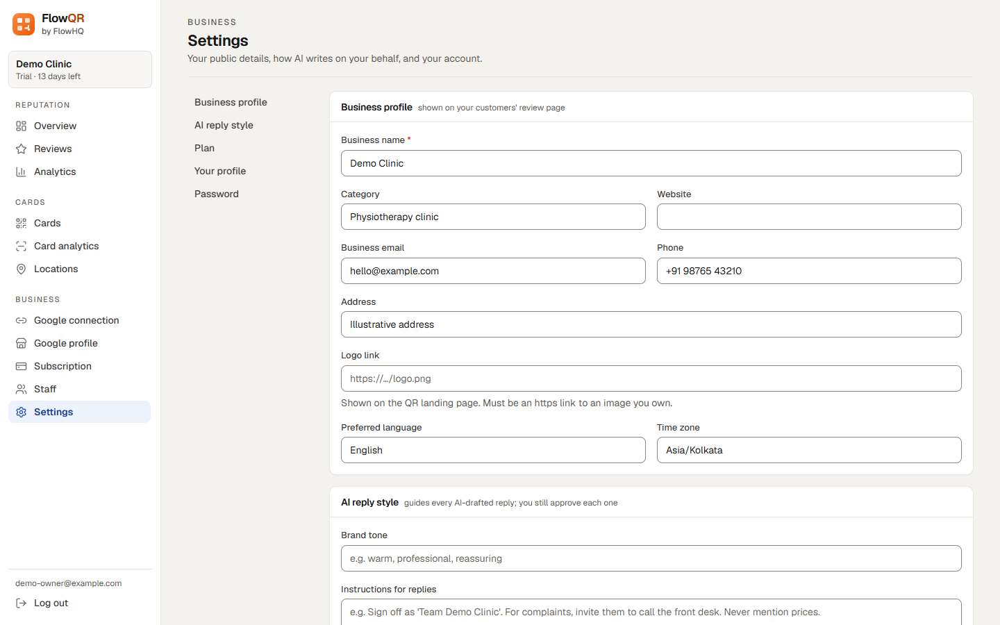 | 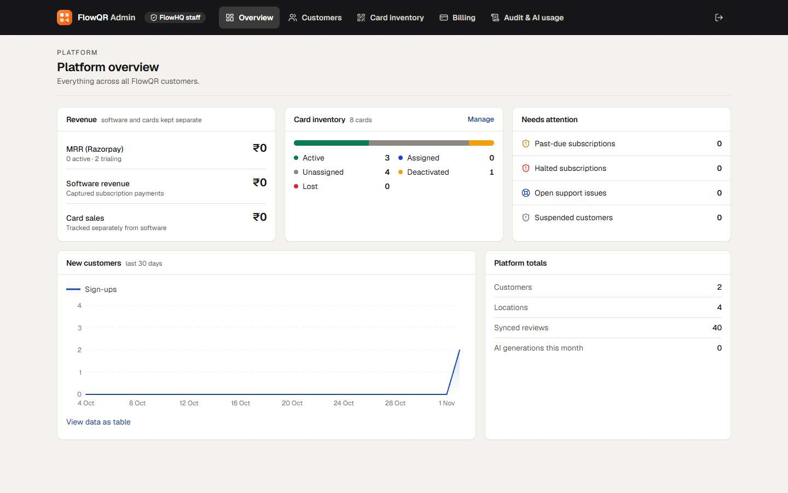 |

## 4. Reality and trust

* No testimonials, no named businesses, no invented metrics. Authenticated screens show only the user's own data; every demo image says so.
* Marketing claims were checked against the code and [`SECURITY.md`](SECURITY.md): Argon2id, PostgreSQL row-level security, Fernet-encrypted tokens,
  AI logs that store sizes not text, the approval workflow, and "published only after Google confirms".
* The product states its real limits: automatic sync and reply publishing need Google-approved Business Profile API access; manual
  review-link mode works without it. FlowQR does not claim any Google affiliation.
* **NFC status.** The backend cannot know whether an NFC tag has been written, so the UI shows "NFC link ready" for live cards and says so,
  rather than claiming a tag is programmed.
* **The poster's QR is a sample.** The supplied print file's QR cannot be decoded, so it does not point at a real card. Every use of the
  artwork is captioned accordingly, and card detail pages show the card's real, scannable QR separately for download and printing.
  Real cards must each be printed with their own generated QR (batch export in the admin console).
* **Google's logo and wordmark** appear in the artwork ("Review us on Google"). That is a decision for FlowHQ rather than the UI, but it is worth
  confirming against Google's brand-use rules for materials you sell; the site footer and the sign-in screen state that FlowQR is not
  affiliated with or endorsed by Google.
* The poster's "F" mark differs from the app's logo (the orange QR-flow tile). Both are FlowHQ assets, and neither was altered; you may
  want to decide which one is the primary mark.

## 5. Backend change (additive)

`GET /cards` and `GET /admin/cards` now include `last_scan_at` (most recent human scan, bots excluded; `null` if never scanned) so
"last scanned" is real. Covered by `test_last_scan_at_reflects_only_human_scans`. No existing field or behaviour changed.

## 6. Route coverage

All 33 routes were captured at three sizes (102 captures). "Overflow" is horizontal page scroll; "console" is browser errors.
Full per-route data is in [`ui-audit/results.json`](ui-audit/results.json).

| Route | Desktop | Tablet | Mobile | Result |
| --- | --- | --- | --- | --- |
| `/` | [img](ui-audit/desktop/home.jpg) | [img](ui-audit/tablet/home.jpg) | [img](ui-audit/mobile/home.jpg) | clean |
| `/pricing` | [img](ui-audit/desktop/pricing.jpg) | [img](ui-audit/tablet/pricing.jpg) | [img](ui-audit/mobile/pricing.jpg) | clean |
| `/login`, `/register` | [login](ui-audit/desktop/login.jpg), [register](ui-audit/desktop/register.jpg) | [login](ui-audit/tablet/login.jpg) | [login](ui-audit/mobile/login.jpg) | clean |
| `/forgot-password`, `/reset-password`, `/accept-invite` | [img](ui-audit/desktop/forgot-password.jpg) | [img](ui-audit/tablet/reset-password.jpg) | [img](ui-audit/mobile/accept-invite.jpg) | clean |
| `/verify-email` | [img](ui-audit/desktop/verify-email.jpg) | [img](ui-audit/tablet/verify-email.jpg) | [img](ui-audit/mobile/verify-email.jpg) | 422 from the deliberately fake token (expected) |
| `/c/[token]` (public card page), unknown token | [img](ui-audit/desktop/card-public.jpg) | [img](ui-audit/tablet/card-public.jpg) | [img](ui-audit/mobile/card-public.jpg) | clean |
| `/onboarding` | [img](ui-audit/desktop/onboarding.jpg) | [img](ui-audit/tablet/onboarding.jpg) | [img](ui-audit/mobile/onboarding.jpg) | clean |
| `/dashboard` (active, and brand-new business) | [img](ui-audit/desktop/dashboard.jpg), [new](ui-audit/desktop/dashboard-new-business.jpg) | [img](ui-audit/tablet/dashboard.jpg) | [img](ui-audit/mobile/dashboard.jpg) | clean |
| `/reviews`, `/reviews/[id]` | [img](ui-audit/desktop/reviews.jpg), [detail](ui-audit/desktop/review-detail.jpg) | [img](ui-audit/tablet/reviews.jpg) | [img](ui-audit/mobile/reviews.jpg) | clean |
| `/cards`, `/cards/[id]`, `/cards/analytics` | [img](ui-audit/desktop/cards.jpg), [detail](ui-audit/desktop/card-detail.jpg) | [img](ui-audit/tablet/cards.jpg) | [img](ui-audit/mobile/cards.jpg) | clean |
| `/analytics` | [img](ui-audit/desktop/analytics.jpg) | [img](ui-audit/tablet/analytics.jpg) | [img](ui-audit/mobile/analytics.jpg) | clean |
| `/locations` | [img](ui-audit/desktop/locations.jpg) | [img](ui-audit/tablet/locations.jpg) | [img](ui-audit/mobile/locations.jpg) | clean |
| `/google` | [img](ui-audit/desktop/google.jpg) | [img](ui-audit/tablet/google.jpg) | [img](ui-audit/mobile/google.jpg) | clean |
| `/profile` (Google profile) | [img](ui-audit/desktop/google-profile.jpg) | [img](ui-audit/tablet/google-profile.jpg) | [img](ui-audit/mobile/google-profile.jpg) | 503 from the API while Google is unconfigured; shown as *Configuration pending* |
| `/subscription`, `/payments` | [sub](ui-audit/desktop/subscription.jpg), [pay](ui-audit/desktop/payments.jpg) | [sub](ui-audit/tablet/subscription.jpg) | [sub](ui-audit/mobile/subscription.jpg) | clean |
| `/staff`, `/settings` | [staff](ui-audit/desktop/staff.jpg), [settings](ui-audit/desktop/settings.jpg) | [staff](ui-audit/tablet/staff.jpg) | [staff](ui-audit/mobile/staff.jpg) | clean (mobile overflow found and fixed) |
| `/admin`, `/admin/customers`, `/admin/customers/[id]`, `/admin/cards`, `/admin/billing`, `/admin/audit` | [admin](ui-audit/desktop/admin.jpg), [customers](ui-audit/desktop/admin-customers.jpg), [cards](ui-audit/desktop/admin-cards.jpg) | [admin](ui-audit/tablet/admin.jpg) | [admin](ui-audit/mobile/admin.jpg) | clean |

### Issues found by the sweep and fixed in this pass

* Mobile Staff scrolled sideways (grid children lacked `min-w-0`): fixed.
* Review status tabs and segmented controls were 36 px on touch: now 44 px on touch, dense on pointer devices.
* Google sync checkboxes were 16 px targets: now inside a 44 px label.
* Pricing table hid two of three plans on phones: replaced with a plan switcher.
* Reviews collapsed to one pane on tablet: a two-pane workspace from 768 px.
* The "average rating" chart dropped to zero on days without reviews: it now leaves gaps.
* Ratings showed raw decimals (4.33): one decimal everywhere.

## 7. Verification

| Check | Result |
| --- | --- |
| `tsc --noEmit` | passes |
| `next build` (production, in the Docker image) | passes, 33 routes |
| Backend test suite (`pytest`, schema rebuilt from migrations) | **140 passed** (139 existing plus 1 new) |
| Route sweep | 102 captures; **0** horizontal overflow; **0** controls without an accessible name; 6 console entries, all expected (see table) |
| Contrast | palette pairs computed numerically (figures in the token comments) |

Not verified: live Google, Gemini and Razorpay (no credentials in this environment; the app shows *configuration pending*), a real
NFC tag, dark appearance (not implemented; tokens are ready), and real devices (checked in desktop Chrome at three viewports).
The frontend has no unit tests, and the Playwright smoke test in `e2e/smoke.js` was not re-run.

## Demo data and how to reproduce this review

Seeding the real database would put fake rows next to real accounts, so the review uses a **separate Compose project** with its own volumes and ports.

```powershell
# 1) Isolated stack (project "flowqr-demo", API on :8100, web on :3100). Override file keeps your main stack untouched.
$env:FLOWQR_TAG="demo"; $env:FRONTEND_URL="http://localhost:3100"; $env:PUBLIC_CARD_BASE_URL="http://localhost:3100"
$env:CORS_ORIGINS="http://localhost:3100"; $env:REQUIRE_VERIFIED_EMAIL="false"; $env:PLATFORM_ADMIN_EMAILS="demo-admin@example.com"
docker compose -p flowqr-demo -f docker-compose.yml -f e2e/compose.demo.yml --project-directory . up -d --build

# 2) Seed (registers through the real API; writes Google-synced reviews and scan events directly)
Get-Content e2e/seed_demo.py | docker compose -p flowqr-demo exec -T api python -

# 3) Capture
BASE_URL=http://localhost:3100 node e2e/capture-product-shots.js   # landing-page screenshots
BASE_URL=http://localhost:3100 node e2e/ui-sweep.js                # every route x 3 sizes -> docs/ui-audit
```

[`e2e/compose.demo.yml`](../e2e/compose.demo.yml) only re-maps the API to :8100 and the web app to :3100.
Demo logins (demo stack only): `demo-owner@example.com`, `demo-admin@example.com`, `demo-new@example.com` (empty business),
`demo-onboarding@example.com`, password `DemoPassw0rd!x`. Tear down with `docker compose -p flowqr-demo down -v`.
Scripts use `playwright`, or `playwright-core` with `CHROME_PATH` pointing at a system Chrome.
